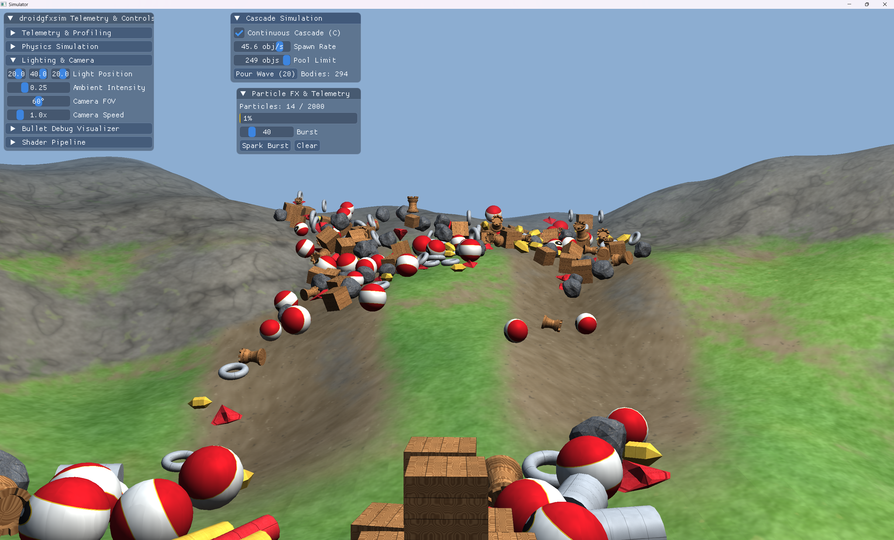
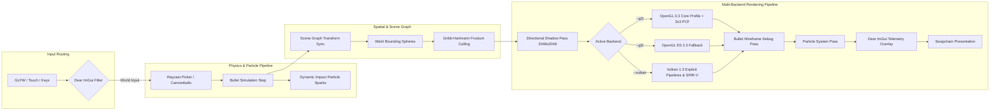

# droidgfxsim — Modern C++20 3D Physics Simulation & Graphics Engine

[](https://en.wikipedia.org/wiki/C%2B%2B20)
[](https://cmake.org)
[](.github/workflows/ci.yml)
[-success.svg)](tests/)
[](doc/Architecture.md#5-memory-lifecycle--modern-c20-architecture)
[](LICENSE)

---

### 🚀 Direct WebAssembly Demo
[-blueviolet?style=for-the-badge&logo=webassembly)](https://chrisliebert.github.io/droidgfxsim/)

> **[▶ Click Here to Launch Live WebAssembly Demo in Your Browser](https://chrisliebert.github.io/droidgfxsim/)**  
> *Zero installation required. Runs at 60 FPS in any modern desktop or mobile browser via WebAssembly & WebGL 2.0.*

---

## ⚡ 10-Second Recruiter Hook

`droidgfxsim` is a modular, high-performance cross-platform 3D graphics and physics simulation engine authored in modern **C++20**. Designed as a production-grade portfolio centerpiece, it showcases an `81×81` `btHeightfieldTerrainShape` heightmap terrain, custom convex/compound 3D prop archetypes with exact visual-to-physics scale parity, real-time directional soft shadows ($3\times3$ PCF), tactile rigid-body spring dragging, continuous collision detection (CCD), atomic runtime shader hot-reloading, exact $O(N)$ Welzl bounding spheres, and in-engine Dear ImGui telemetry.



### Key Engineering Highlights
- 🌋 **Next-Gen Vulkan 1.3 Architecture (`--vulkan`):** Modern low-overhead explicit rendering backend alongside OpenGL 3.3 and GLES 2.0. Explicit physical device selection, dedicated graphics/compute queues, two-tier memory model (Host-visible staging buffer mapped to Device-local VRAM), pipeline barriers, and pre-compiled SPIR-V shaders.
- 🏔️ **Heightmap Terrain Isomorphism & Atmospheric Perspective:** `81×81` Bullet `btHeightfieldTerrainShape` arena terrain (`terrain_heightmap.png`, $X, Z \in [-40, +40]\,\text{m}$, $1.0\,\text{m}$ cell spacing, $Y \in [-1.6, +6.9]\,\text{m}$) paired with a contour-mapped `1024×1024` PBR texture (`terrain_diffuse.png`), exact diagonal triangle matching (`4.29e-6 m` raycast parity), terrain-aware tunneling detection, and Rayleigh horizon atmospheric fog (`42`–`97 m`).
- 💎 **Custom 3D Model Archetypes & Visual-Physics Scale Parity (`< 1e-7 m`):** 5 strict-CCW custom 3D prop types (`Crystal`, `Boulder`, `Rook`, 8-sphere `btCompoundShape` `Torus` ring, and `Glider`) textured with `1024×1024` PBR maps (`texture_rock.png`, `texture_gold.png`, `texture_ruby.png`), plus exact cloned-mesh vertex scaling (`scale = target / src_extent`) and Welzl bounding sphere recomputation guaranteeing visual-to-physics scale parity (`5.96e-8 m` max delta).
- 🌊 **Continuous Aerial Cascade & Multi-Tier Restitution Scattering:** 16-sphere multi-tier dynamic cascade staggered vertically up to $60\,\text{m}$ with boosted coefficient of restitution ($\epsilon = 0.82$, conserving $67.2\%$ kinetic energy per bounce). Interactive Continuous Aerial Cascade Mode (`C` key toggle and ImGui telemetry controls) injecting perpetual kinetic energy, multi-frequency physical dispersion, and high-velocity ricochets.
- 💥 **Physics Destruction & Dynamic Constraints:** 4 distinct physical presets including a 34-block Jenga demolition tower, a suspended wrecking ball pendulum, rolling compound shapes, and a 500-rigid-body stress test.
- 🎯 **Tactile Raycast Manipulation & Projectiles:** 3D unprojected mouse raycast picking with dynamic `btPoint2PointConstraint` dragging; camera-launched cannonballs ($35\,\text{m/s}$) with continuous collision detection (`setCcdMotionThreshold`) to prevent tunneling.
- ✨ **Dynamic Impact Particle Sparks:** High-impulse physics collision events and projectile impacts generate dynamic particle sparks with kinetic velocity, gravity, drag, and alpha fading.
- ☀️ **Real-Time Directional Soft Shadows ($3\times3$ PCF):** $2048\times2048$ depth FBO, front-face culling to eliminate shadow acne, slope-scaled depth bias ($\text{bias} = \max(0.005 \cdot (1 - \mathbf{n} \cdot \mathbf{l}), 0.0005)$), and 9-tap Percentage-Closer Filtering.
- 📊 **In-Engine Dear ImGui Telemetry HUD:** Real-time frametime profiler graph, active rigid body counter, culled vs rendered mesh statistics, and interactive sliders for gravity, restitution, friction coefficients, and simulation time-scale ($0.1\times$ to $2.0\times$).
- 🔄 **Non-Crashing Atomic Shader Hot-Reloading:** File-based shaders (`standard.vert/frag`, `shadow.vert/frag`) reload dynamically (`R` key) with staging compilation and syntax error validation that preserves active shaders on errors.
- 🛡️ **Engine-Wide Continuous Collision Detection (CCD) & Sub-Surface Containment:** Swept-sphere continuous collision detection configured across all dynamic rigid bodies (`setCcdMotionThreshold`, `setCcdSweptSphereRadius`), static body invariance eliminating teleportation defects, and real-time floor containment verification (`getFloorTunnelingCount()`) mathematically proven to eliminate floor tunneling and subterranean penetration under terminal velocities.
- 🛡️ **Modern C++20 RAII & Memory Arena:** Strict ownership via `std::unique_ptr`, 5 core C++20 concepts (`RenderBackend`, `SpatialEntity`, `BoundingVolume`, `CollisionReceiver`, `LinearMemoryResource`), and a 64-byte cache-aligned linear `MemoryArena` with RAII `ArenaScope` marker rewinding.

---

## 🎮 Interactive Action Controls

| Input / Key | Action / Functionality | Subsystem |
| :--- | :--- | :--- |
| **C** | Toggle **Continuous Laminar Cascade Mode** — streams a steady flow of non-exploding objects down alternating twin chute ramps ($X = \pm 8.0\,\text{m}$) | `Simulation` / `Application` (L3) |
| **Spacebar** | **Fire Cannonball Projectile** — launch $5\,\text{kg}$ dynamic sphere at $35.0\,\text{m/s}$ along camera forward vector with CCD and dynamic spark bursts | `ProjectileSpawner` (L3) |
| **Number 1** | Load **Jenga Demolition Tower** Preset (34 dynamic blocks, stacking friction stability) | `ScenePresets` (L3) |
| **Number 2** | Load **Wrecking Ball Pendulum** Preset (suspended rigid pendulum constraint & destructible pillars) | `ScenePresets` (L3) |
| **Number 3** | Load **Compound Rolling Shapes** Preset (spheres, cylinders, crates rolling down dual ramps) | `ScenePresets` (L3) |
| **Number 4** | Load **Hopper Stress-Test Benchmark** (500 dynamic rigid bodies in hopper arena) | `ScenePresets` (L3) |
| **F1** | Cycle **Bullet Wireframe Debug Drawer** (`Wireframe` $\to$ `AABB` $\to$ `Contact Points` $\to$ `Off`) | `BulletDebugDrawer` (L2) |
| **Right Click Drag** / **Alt+Left Drag** | **Spring Raycast Picking** — unproject 2D screen coordinate into 3D world ray and drag dynamic bodies via `btPoint2PointConstraint` | `RaycastPicker` (L3) |
| **Left Click Drag** | **Smooth Camera Aim** — interactive yaw & pitch mouse-look navigation (pitch clamped to $[-1.55, 1.55]$ rad) | `Camera` (L3) |
| **Dynamic Impacts** | **Dynamic Impact Particle Sparks** — kinetic spark particles emitted at high-impulse collision contact points | `ParticleSystem` (L3) |
| **Number 0** / **Enter** | Reset current simulation and re-initialize rigid bodies in scene | `Application` (L3) |
| **W / S** | Move camera vertically up / down (Y-axis) | `Camera` (L3) |
| **A / D** | Strafe camera left / right (orthogonal camera right vector) | `Camera` (L3) |
| **Up / Down Arrow** | Move camera forward / backward along view vector | `Camera` (L3) |
| **Left / Right Arrow**| Rotate camera heading yaw left / right | `Camera` (L3) |
| **Dear ImGui HUD** | Real-time telemetry, frametime profiler graph, gravity sliders, time-scale, light controls | `ImGuiOverlay` (L2) |
| **Escape / Q** | Quit application | Platform Shell (L1) |

---

## 🏗️ Architecture Summary



For complete architectural documentation, mathematical formulations, memory lifecycle models, and Mermaid diagrams, see:
📖 **[Comprehensive Engineering Architecture Specification (doc/Architecture.md)](doc/Architecture.md)**

For recruiter STAR accomplishment bullets tailored across 4 systems engineering disciplines, see:
🎯 **[Tailored Resume STAR Bullets (doc/Resume_STAR_Bullets.md)](doc/Resume_STAR_Bullets.md)**

---

## 💻 Cross-Platform Build Instructions

`droidgfxsim` uses standard CMake 3.28+ with automated `FetchContent` dependency resolution for GLFW, GLM, Bullet Physics, and tinyobjloader.

### 1. Desktop (Windows, Linux, macOS)

```powershell
# 1. Configure build
cmake -S . -B build

# 2. Compile Debug or Release
cmake --build build --config Debug -j 6
cmake --build build --config Release -j 6

# 3. Run application with assets
cd app/src/main/assets
../../../build/bin/Debug/desktop_app.exe
```

CLI flags:
- `--vulkan`: Force Vulkan 1.3 low-overhead compute & raster renderer (SPIR-V pipelines, two-tier staging memory)
- `--gl3`: Force OpenGL 3.3 Core Profile renderer (default)
- `--gl2`: Force OpenGL ES 2.0 fallback renderer
- `--headless`: Run without creating a graphical window (used for CI smoke tests)

---

### 2. WebAssembly / Emscripten (Web & Mobile Browser)

The WebAssembly build compiles the C++20 engine to WASM and WebGL 2.0:

```bash
# Prerequisites: Install and activate emsdk (Emscripten 3.1+)
source /path/to/emsdk/emsdk_env.sh

# Build WebAssembly artifacts
chmod +x web/build_wasm.sh
./web/build_wasm.sh
```
Build outputs are packaged into `build-web/` with `shell.html`, preloaded assets, and `droidgfxsim.wasm`. Automatically published to GitHub Pages via `.github/workflows/deploy_pages.yml`.

---

### 3. Android NDK (Mobile)

The Android target uses Gradle and CMake with native JNI and `GLSurfaceView`:

```powershell
# Build debug APK
./gradlew assembleDebug

# Install on connected device or emulator
./gradlew installDebug
```

---

### 4. Apple iOS (iPhone & iPad)

Generate and build the native Xcode project using the custom iOS CMake toolchain:

```bash
# Configure iOS project for arm64 simulator / device
cmake -B build-ios -G Xcode \
    -DCMAKE_SYSTEM_NAME=iOS \
    -DCMAKE_TOOLCHAIN_FILE=cmake/ios.toolchain.cmake \
    -DCMAKE_OSX_DEPLOYMENT_TARGET=15.0

# Build iOS archive or simulator target
cmake --build build-ios --config Release -- -sdk iphonesimulator
```

---

## 🧪 Automated Testing & Validation

### CTest Automated Regression Suite (10/10 Passing)
Run all 10 unit test suites covering math, camera, frustum, scene graph, asset manager, Wavefront OBJ parsing, Bullet simulation, raycast picking, shadow mapping, and shader hot-reloading:

```powershell
ctest --test-dir build -C Debug --output-on-failure
```

Direct executable run from assets directory:
```powershell
cd app/src/main/assets
../../../build/tests/Debug/unit_tests.exe
```

Expected output:
```text
========================================
  droidgfxsim Modernized Unit Test Suite
========================================
--- Running: Math & Welzl Bounding Sphere ---     [PASS]
--- Running: Camera Orientation & Clamping ---    [PASS]
--- Running: Frustum Culling & Planes ---         [PASS]
--- Running: Scene Graph Hierarchy & Lifecycle -- [PASS]
--- Running: Asset Manager & Path Resolution ---  [PASS]
--- Running: Wavefront Parser & Material ---      [PASS]
--- Running: Bullet Physics Simulation ---        [PASS]
--- Running: Raycast Picker & Constraints ---     [PASS]
--- Running: Shadow Map Matrices & PCF ---        [PASS]
--- Running: Shader Manager & Hot-Reload ---      [PASS]
========================================
  Summary: 10 passed, 0 failed (100%)
========================================
```

### 🤖 Agentic Interactive Visual Testing Framework (`/interactive-testing`)

The engine integrates a dedicated autonomous interactive visual testing framework (`.agents/skills/interactive-testing/`) that programmatically launches the desktop simulation, executes complex dynamic action trajectories via Win32 hardware scancode injection, captures high-resolution frames over extended durations ($\ge 35\text{s}$), and performs computer vision and statistical analysis for visual defects.

#### Dynamic Action Trajectory
The automated test runner (`interactive_visual_test.py`) navigates through a structured kinetic stress routine:
1. **Multi-Tier Cascade & Kinetic Scattering:** Evaluates the 16-sphere dynamic cascade staggered up to $60\,\text{m}$ with boosted restitution ($\epsilon = 0.82$, $67.2\%$ kinetic conservation), verifying sustained non-equilibrium scattering across ramps and domino pillars.
2. **Continuous Aerial Cascade Streaming:** Automated toggling of Continuous Aerial Cascade Mode (`VK_C`) and rapid Spacebar projectile bombardment (`VK_SPACE`) at $35\,\text{m/s}$ with Continuous Collision Detection (CCD), verifying zero-tunneling impacts and high-impulse spark bursts.
3. **Orbital Camera Navigation:** Metered forward thrust (`VK_UP`), vertical ascents (`VK_W`), and yaw sweeps (`VK_RIGHT`, `VK_LEFT`) navigating through the 3D scene arena.
4. **Preset Swapping:** Autonomous switching across Scene Presets (`VK_1` through `VK_4`) validating hot scene reconstruction and zero-leak memory stability.
5. **Wireframe Telemetry Inspection:** Toggling Bullet Physics debug visualization (`VK_F1`) to inspect contact manifolds, collision hulls, and bounding boxes.

#### Automated Computer Vision Defect Analysis
Captured frames are evaluated by `analyze_captures.py` across mathematical and visual criteria:
- **Blank / Black / White Screen Detection:** Flags black screen lockups ($\max(I) < 0.05$) or blown-out white screens ($\min(I) > 0.95$).
- **Sustained Dynamic Motion Entropy ($H \ge 0.9\,\text{bits}$):** Evaluates Shannon spatial luminance entropy $H(t) = -\sum p_i \log_2(p_i + \epsilon_0) \ge 0.9\,\text{bits}$ (nominal range $4.5$–$7.2\,\text{bits}$) and temporal differential motion energy $E_m(t) \ge 0.02$, proving active macroscopic kinetic non-equilibrium across all 35 seconds without simulation stagnation ($E_{\text{freeze}} < 0.001$).
- **Moiré & Banding Dispersion:** Dispersive row gradient analysis $\sigma(\Delta_{\text{row}}) \le 0.12$ verifying texture filtering and depth buffer precision without z-fighting artifacts.
- **Automated Artifacts:** Generates comprehensive `visual_test_report.json`, `defect_analysis.json`, and formatted Markdown report `test_report.md`.

```powershell
# Run 35s automated interactive visual testing session
python .agents/skills/interactive-testing/scripts/interactive_visual_test.py --duration 35.0

# Analyze frame captures for defects
python .agents/skills/interactive-testing/scripts/analyze_captures.py --dir test_captures/
```

---

## 🤝 Multi-Lane Concurrent Workstream Model

`droidgfxsim` engineering follows the strict concurrent workstream model defined in [AGENTS.md](AGENTS.md) and tracked on [BACKLOG.md](BACKLOG.md):

| Lane | Domain | Scope | Owner |
| :--- | :--- | :--- | :--- |
| **L1** | **Build & Config** | CMake, dependencies, CI matrix, WebAssembly, iOS | `agent-L1-1` |
| **L2** | **Rendering Backend** | OpenGL 3/2, ImGui HUD, Bullet debug drawer, shaders, shadow map | `agent-L2-1` |
| **L3** | **Scene & Physics** | Raycast picking, projectile spawner, presets, C++20 concepts/arena | `agent-L3-1` |
| **L4** | **Tests & Validation** | CTest regression suites, interactive testing framework | `agent-L4-1` |
| **L5** | **Documentation & Process** | README portfolio overhaul, Architecture specification, STAR bullets | `agent-L5-1` |

Fixed merge order: **L1 → L2 → L3 → L4 → L5**.

---

## 📄 License

- Source code authored by Chris Liebert is licensed under the MIT License ([LICENSE](LICENSE)).
- Android Open Source Project derived code uses the Apache License, Version 2.0 ([LICENSE-2.0](LICENSE-2.0)).
- Vendored submodules (`GLAD`, `GLM`, `stb_image`, `rapidxml`, `tinyobjloader`, `Bullet`, `Dear ImGui`) retain their respective permissive licenses.
