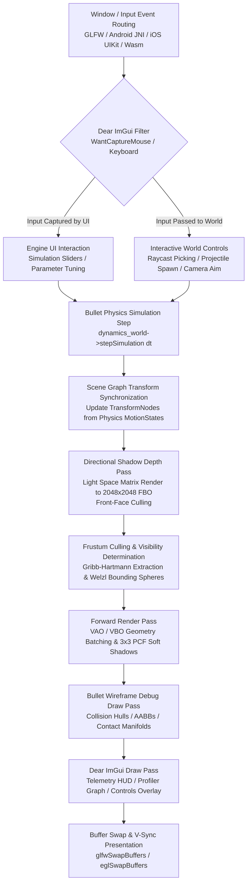
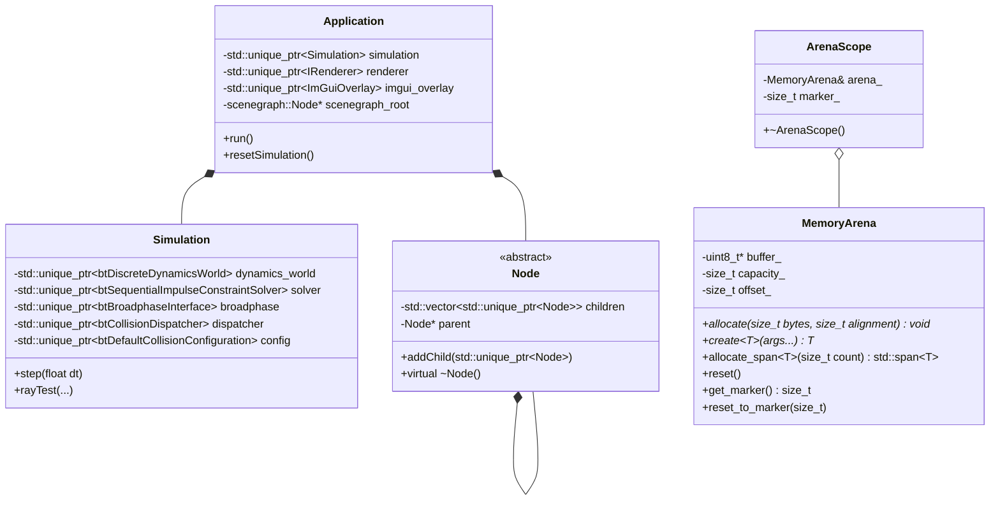

# droidgfxsim — Engineering Architecture & Subsystem Specification

`droidgfxsim` is a cross-platform, high-performance 3D graphics engine and rigid-body physics simulation environment written in modern C++20. It delivers a modular architecture running identically across Desktop (Windows, Linux, macOS), Mobile (Android NDK, Apple iOS), and Web (WebAssembly / WebGL 2.0).

---

## 1. High-Level Engine Pipeline

The engine architecture decouples input event dispatch, physics simulation, spatial culling, multi-pass rendering, and telemetry overlays. Each frame processes through a strictly ordered pipeline:



---

## 2. Core Subsystems & Modular Architecture

```mermaid
graph TB
    subgraph PlatformLayer["Platform & OS Abstraction Layer"]
        GLFW["Desktop (GLFW 3.4)<br/>Windows / Linux / macOS"]
        AndroidNDK["Android NDK (JNI / EGL)<br/>GLSurfaceView"]
        iOS["Apple iOS (UIKit)<br/>GLKViewController"]
        WASM["WebAssembly (Emscripten)<br/>HTML5 Shell / WebGL 2.0"]
    end

    subgraph CoreEngine["Engine Core Runtime (droidgfxsim_core)"]
        App["Application Controller<br/>Main Loop & Lifecycle"]
        AssetMgr["AssetManager<br/>Canonical Fallback Resolution"]
        MemArena["MemoryArena & Concepts<br/>64-Byte Cache Aligned / RAII Scoping"]
    end

    subgraph PhysicsModule["Physics & Interaction Pipeline"]
        Sim["Simulation<br/>btDiscreteDynamicsWorld"]
        Raycast["RaycastPicker<br/>btPoint2PointConstraint Drag"]
        Projectile["ProjectileSpawner<br/>CCD Dynamic Cannonballs"]
        Presets["ScenePresets<br/>Jenga / Wrecking Ball / Compound / Stress"]
    end

    subgraph SpatialSceneGraph["Spatial Scene Graph & Visibility"]
        SceneGraph["Hierarchical Scene Graph<br/>scenegraph::Node Hierarchy"]
        Welzl["MathUtil::welzlBoundingSphere<br/>Exact O(N) Minimal Enclosing Sphere"]
        Frustum["Frustum<br/>Gribb-Hartmann 6-Plane Extraction"]
    end

    subgraph RenderingBackend["Modular Rendering Backend (IRenderer)"]
        IRenderer["IRenderer Interface<br/>Decoupled Render Abstraction"]
        GL3["GL3SceneGraphRenderer<br/>Core Profile 3.3 / ES 3.0 VAOs"]
        GL2["GL2SceneGraphRenderer<br/>Legacy ES 2.0 Fallback"]
        ShadowMap["ShadowMap FBO<br/>2048x2048 Depth & Light Matrix"]
        ShaderMgr["ShaderManager<br/>Atomic Hot-Reloading & GLSL Injection"]
        DebugDrawer["BulletDebugDrawer<br/>btIDebugDraw Line Renderer"]
        ImGuiHUD["ImGuiOverlay<br/>Real-Time Telemetry HUD"]
    end

    PlatformLayer --> CoreEngine
    CoreEngine --> PhysicsModule
    CoreEngine --> SpatialSceneGraph
    CoreEngine --> RenderingBackend
    PhysicsModule --> SpatialSceneGraph
    SpatialSceneGraph --> RenderingBackend
```



---

## 3. Subsystem Breakdown & Design Contracts

### 3.1 Input Event Routing & Telemetry Filtering
All user input (keyboard presses, mouse motion, mouse buttons, touch gestures) is intercepted by `ImGuiOverlay` before reaching gameplay code:
1. `ImGui_ImplGlfw_CursorPosCallback` / `MouseButtonCallback` process raw OS events.
2. If `ImGui::GetIO().WantCaptureMouse` is true, mouse delta is consumed by the telemetry HUD and blocked from camera look or raycast picking.
3. If `ImGui::GetIO().WantCaptureKeyboard` is true, keystrokes are blocked from scene preset triggers or camera navigation.
4. When uncaptured:
   - **Left Click Drag:** Invokes `RaycastPicker::pick()` and `RaycastPicker::drag()`.
   - **Right Click Drag:** Rotates camera view angles (yaw and pitch with $[-1.55, 1.55]$ radian clamping).
   - **Spacebar:** Triggers `ProjectileSpawner::spawnFromCamera()` with initial impulse $35.0\,\text{m/s}$.
   - **Number Keys (1–4):** Triggers `ScenePresets::loadPreset()`.
   - **F1:** Toggles `BulletDebugDrawer` wireframe modes (`DBG_DrawWireframe`, `DBG_DrawAabb`, `DBG_DrawContactPoints`).
   - **R:** Triggers `ShaderManager::atomicReload()` on active shaders.
   - **F10:** Single-steps physics simulation by $\Delta t = 1/60\,\text{s}$.

### 3.2 Physics Simulation & Constraint Solver
- **Discrete Dynamics World:** Backed by Bullet's `btDiscreteDynamicsWorld`, `btDbvtBroadphase`, and `btSequentialImpulseConstraintSolver`.
- **Dynamic Raycast Picking:**
  - Converts screen coordinates $(x, y)$ to NDC $[-1, 1]$.
  - Unprojects clip-space points via $(\mathbf{P} \times \mathbf{V})^{-1}$ to determine world-space near and far ray bounds.
  - Queries `dynamics_world->rayTest()`. Upon dynamic rigid-body intersection, binds a single-body `btPoint2PointConstraint` at local pivot $\mathbf{T}^{-1}_{\text{body}} \mathbf{x}_{\text{hit}}$.
  - Clamps maximum constraint impulse to $30.0\,\text{N}\cdot\text{s}$ with low tau ($0.001$) to create a stiff, responsive dragging spring while preventing solver instability.
- **Continuous Collision Detection (CCD):** Dynamic projectiles configure `setCcdMotionThreshold(0.2f)` and `setCcdSweptSphereRadius(0.2f)` to guarantee zero tunneling against thin geometry.
- **Dynamic Scene Presets:** 4 sandboxes managed via `ScenePresets::loadPreset()`:
  - *Jenga:* 34 stacked rectangular blocks testing contact solver friction and stacking equilibrium.
  - *Wrecking Ball:* Suspended pendulum constraint smashing into destructible pillar structures.
  - *Compound Shapes:* Multi-geometry obstacles, incline rolling ramps, and domino chains.
  - *Stress Test:* Hopper arena with 500 dynamic rigid bodies falling under gravity.

### 3.3 Spatial Scene Graph & Culling Architecture
The scene is represented as an N-ary hierarchy of `scenegraph::Node` objects:
- `TransformNode`: Holds local translation, rotation, and scaling matrices. On every simulation tick, rigid body motion states write directly into `TransformNode` world matrices.
- `GeometryNode`: Holds mesh data, VAO/VBO handles, material descriptors, and precomputed Welzl bounding spheres.
- `PhysicsNode`: Links dynamic Bullet rigid bodies to visual geometry.

---

## 4. Mathematical Formulations

### 4.1 Welzl Minimal Enclosing Bounding Sphere ($O(N)$)
Rather than relying on loose AABB center-extent spheres or Ritter approximations, `droidgfxsim` computes the exact minimal enclosing bounding ball in expected linear time using Emo Welzl's randomized recursive algorithm.

Given a point set $P \subset \mathbb{R}^3$ of $N$ vertices and a support set of boundary points $R$ ($|R| \le 4$):

$$\text{welzl}(P, R) = \begin{cases} 
\text{sphereFromBoundary}(R) & \text{if } P = \emptyset \text{ or } |R| = 4 \\
\text{welzl}(P \setminus \{p\}, R) & \text{if } p \in \text{welzl}(P \setminus \{p\}, R) \\
\text{welzl}(P \setminus \{p\}, R \cup \{p\}) & \text{otherwise}
\end{cases}$$

The base case boundary solver solves circumspheres analytically:
- **$|R| = 0$:** $B = (\mathbf{0}, 0)$
- **$|R| = 1$:** $B = (\mathbf{p}_0, 0)$
- **$|R| = 2$:** $B = \left( \frac{\mathbf{p}_0 + \mathbf{p}_1}{2}, \frac{\|\mathbf{p}_1 - \mathbf{p}_0\|}{2} \right)$
- **$|R| = 3$:** The circumcenter of triangle $(\mathbf{p}_0, \mathbf{p}_1, \mathbf{p}_2)$ lies in the triangle plane at:
  $$\mathbf{c} = \mathbf{p}_0 + \frac{\|\mathbf{d}_2\|^2 (\mathbf{d}_1 \times \mathbf{n}) \times \mathbf{d}_1 + \|\mathbf{d}_1\|^2 \mathbf{d}_2 \times (\mathbf{d}_1 \times \mathbf{n})}{2 \|\mathbf{d}_1 \times \mathbf{d}_2\|^2}$$
  where $\mathbf{d}_1 = \mathbf{p}_1 - \mathbf{p}_0$, $\mathbf{d}_2 = \mathbf{p}_2 - \mathbf{p}_0$, and $\mathbf{n} = \mathbf{d}_1 \times \mathbf{d}_2$.
- **$|R| = 4$:** Circumsphere of tetrahedron solved via Cramer's rule on the $4 \times 4$ determinant system:
  $$\begin{vmatrix} 
  \|\mathbf{x}\|^2 & x & y & z & 1 \\
  \|\mathbf{p}_0\|^2 & p_{0,x} & p_{0,y} & p_{0,z} & 1 \\
  \|\mathbf{p}_1\|^2 & p_{1,x} & p_{1,y} & p_{1,z} & 1 \\
  \|\mathbf{p}_2\|^2 & p_{2,x} & p_{2,y} & p_{2,z} & 1 \\
  \|\mathbf{p}_3\|^2 & p_{3,x} & p_{3,y} & p_{3,z} & 1 
  \end{vmatrix} = 0$$

### 4.2 Gribb-Hartmann Frustum Plane Extraction
View frustum culling extracts 6 clipping planes directly from the combined view-projection matrix $\mathbf{M} = \mathbf{P} \times \mathbf{V}$ in a single pass without matrix inversion:

Let $\mathbf{m}_{\text{row}, i}$ denote the $i$-th row vector of $\mathbf{M}$:

$$\begin{aligned}
\mathbf{\pi}_{\text{left}}   &= \mathbf{m}_{\text{row}, 4} + \mathbf{m}_{\text{row}, 1} \\
\mathbf{\pi}_{\text{right}}  &= \mathbf{m}_{\text{row}, 4} - \mathbf{m}_{\text{row}, 1} \\
\mathbf{\pi}_{\text{bottom}} &= \mathbf{m}_{\text{row}, 4} + \mathbf{m}_{\text{row}, 2} \\
\mathbf{\pi}_{\text{top}}    &= \mathbf{m}_{\text{row}, 4} - \mathbf{m}_{\text{row}, 2} \\
\mathbf{\pi}_{\text{near}}   &= \mathbf{m}_{\text{row}, 4} + \mathbf{m}_{\text{row}, 3} \\
\mathbf{\pi}_{\text{far}}    &= \mathbf{m}_{\text{row}, 4} - \mathbf{m}_{\text{row}, 3}
\end{aligned}$$

Each plane equation $\mathbf{\pi}_k = (A_k, B_k, C_k, D_k)$ is normalized:
$$A_k' = \frac{A_k}{\sqrt{A_k^2 + B_k^2 + C_k^2}}, \quad D_k' = \frac{D_k}{\sqrt{A_k^2 + B_k^2 + C_k^2}}$$

A bounding sphere $(\mathbf{c}, r)$ is culled if for any plane $k \in \{1 \dots 6\}$:
$$\mathbf{n}_k \cdot \mathbf{c} + D_k' < -r$$

### 4.3 Directional Shadow Mapping & $3\times3$ PCF Filtering
1. **Light-Space Projection:**
   Directional sun light is defined with light direction $\mathbf{l}$. An orthographic projection matrix $\mathbf{P}_{\text{light}}$ spanning $[-30, 30] \times [-30, 30] \times [1, 100]$ is combined with look-at view matrix $\mathbf{V}_{\text{light}}$:
   $$\mathbf{M}_{\text{light}} = \mathbf{P}_{\text{light}} \times \mathbf{V}_{\text{light}}$$

2. **Depth Pass:**
   Scene geometry is rendered into a $2048 \times 2048$ 24-bit depth texture with front-face culling (`glCullFace(GL_FRONT)`) to eliminate self-shadowing acne on planar surfaces.

3. **Slope-Scaled Depth Bias:**
   In `standard.frag`, the depth comparison bias dynamically scales with surface slope relative to incident light:
   $$\text{bias} = \max\left(0.005 \cdot (1.0 - \mathbf{n} \cdot \mathbf{l}),\, 0.0005\right)$$

4. **Percentage-Closer Filtering (PCF):**
   Shadow softness is evaluated by sampling a $3 \times 3$ kernel centered at projected light coordinates $(u, v)$:
   $$\text{shadow}(u, v, z) = \frac{1}{9} \sum_{x=-1}^{1} \sum_{y=-1}^{1} \text{step}\left(z - \text{bias},\, D\left(u + x \cdot \Delta u,\, v + y \cdot \Delta v\right)\right)$$
   where $\Delta u = \Delta v = \frac{1}{2048} \approx 0.00048828$.

---

## 5. Memory Lifecycle & Modern C++20 Architecture



### 5.1 RAII Ownership & Smart Pointer Invariants
- **Zero Raw Owning Pointers:** All subsystem lifecycles (`Simulation`, `IRenderer`, `ImGuiOverlay`) are bound to `std::unique_ptr`.
- **Hierarchical Node Tree:** Scene graph child nodes are owned as `std::vector<std::unique_ptr<scenegraph::Node>>`. Destructors are strictly `virtual`, guaranteeing clean recursive deallocation of leaf geometry and transform buffers on scene reset.
- **Bullet Resource Encapsulation:** Collision shapes, motion states, rigid bodies, and constraints are registered in managed containers and released systematically in reverse allocation order, eliminating memory leaks across preset changes.

### 5.2 Contiguous Cache-Aligned Memory Arena
High-frequency per-frame allocations (e.g., dynamic line segments for Bullet debug draw, transient raycast hit arrays, frustum plane queries) utilize `MemoryArena`:
- **64-Byte Cache Alignment:** Every allocation is aligned to `kDefaultCacheAlignment = 64`, eliminating false sharing and matching modern CPU L1 cache line boundaries.
- **$O(1)$ Bump Allocation:** Advance bump pointer with `std::align` validation.
- **Non-Owning Views:** Exposes `allocate_span<T>(count)` returning standard C++20 `std::span<T>`, preventing intermediate heap copies.
- **RAII Scoped Rewind:** `ArenaScope` captures current arena watermark upon construction and automatically rewinds `offset_` on scope termination.

### 5.3 C++20 Concepts
Subsystem boundaries are statically checked at compile time using dedicated C++20 concepts:
- `RenderBackend<T>`: Verifies renderer types implement `void render(scenegraph::Node*, Camera*)`.
- `SpatialEntity<T>`: Verifies spatial transform types provide valid 64-bit alignment and matrix extraction.
- `BoundingVolume<T>`: Validates sphere radius and center accessors.
- `CollisionReceiver<T>`: Enforces Bullet force application contracts.
- `LinearMemoryResource<T>`: Constrains memory arenas to enforce `allocate`, `reset`, `used_bytes`, and `capacity`. Statically validated via:
  ```cpp
  static_assert(LinearMemoryResource<MemoryArena>, "MemoryArena must fulfill LinearMemoryResource concept");
  ```

---

## 6. Cross-Platform Runtime Matrix

| Subsystem / Layer | Desktop (Win / Linux / macOS) | WebAssembly (Emscripten) | Android NDK | Apple iOS |
| :--- | :--- | :--- | :--- | :--- |
| **Window & Events** | GLFW 3.4 | Emscripten HTML5 Canvas | Android `GLSurfaceView` JNI | UIKit `GLKViewController` |
| **Graphics API** | OpenGL 3.3 Core Profile | WebGL 2.0 (GLES 3.0) | OpenGL ES 3.0 | OpenGL ES 3.0 (`CAEAGLLayer`) |
| **Extension Loader** | GLAD / Desktop OpenGL | Native Browser GL3 | NDK `<GLES3/gl3.h>` | iOS `<OpenGLES/ES3/gl.h>` |
| **Physics Engine** | Bullet 3.25 (x86_64 / arm64) | Bullet 3.25 (WASM-32) | Bullet 3.25 (arm64-v8a) | Bullet 3.25 (arm64) |
| **Asset Pipeline** | Relative / Canonical path | `--preload-file` virtual FS | `AAssetManager` / APK Assets | `CFBundleCopyResourcesDirectoryURL` |
| **Telemetry HUD** | Dear ImGui (GLFW + GL3) | Web Shell HUD / ImGui | Mobile Debug Overlay | Native UIKit Gestures |
| **Continuous Integration** | GitHub Actions (MSVC/Clang) | Emscripten CI / Pages Deploy | Gradle Android NDK CI | Xcode Toolchain CI |
